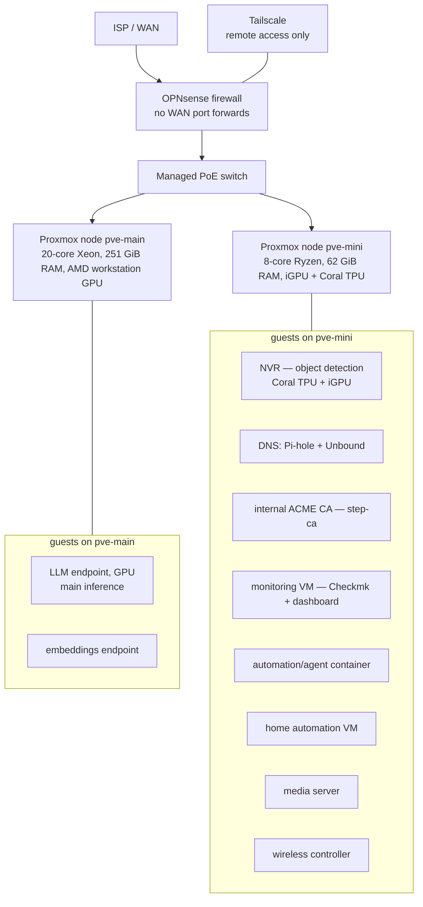

# Homelab — architecture and decisions

A two-node Proxmox VE lab behind an OPNsense firewall, used as a real operations
environment: services that have to stay up, monitored, patched on a defined process,
and documented well enough to hand over. This repo describes the architecture, the
decisions behind it, the lessons from things that broke, and operations.

All addresses here are documentation ranges (RFC 5737 / generic example space), and
hosts are named by role, not by hostname.

## What the lab is for

- Practice network and systems administration end to end: virtualization, firewalling,
  DNS, PKI, monitoring, backups, patch management.

- Operate an AI agent under change control (see the companion `ai-agent-ops` repo).

## Architecture

The home LAN does not currently use VLAN segmentation. Intrusion detection is
disabled; segmentation and further network work remain in progress.

## Hardware summary (generic)

| Node | CPU | RAM | Accelerators | Storage | Role |
|---|---|---|---|---|---|
| pve-main | 20-core Xeon (E5 v4-class) | 251 GiB | AMD workstation GPU (Radeon-class), display-only Quadro | LVM-thin | GPU inference guests |
| pve-mini | 8-core Ryzen U-series | 62 GiB | AMD iGPU + Google Coral Edge TPU (PCIe) | ZFS | most services, NVR, monitoring, agent |

Plus: OPNsense on a small x86 box, a managed PoE+ switch, and a second switch.

## Services by role

| Role | What runs it | Notes |
|---|---|---|
| Firewall / gateway / DHCP | OPNsense | LAN bridge, single NAT, dnsmasq DHCP, zero WAN port forwards |
| DNS chain | Pi-hole → Unbound (DoT upstream) | lab-internal resolvers only |
| Virtualization | Proxmox VE on both nodes | separate installs; not clustered |
| Internal PKI | step-ca as an ACME server | private CA |
| Monitoring | Checkmk + dashboard in Docker on a dedicated VM | PVE API tokens scoped to an auditor role, SNMPv3 to the switch |
| Media | open-source media server | iGPU transcode |
| Home automation | Home Assistant OS VM | USB radio passthrough |
| Wireless | UniFi controller guest + APs | |
| LLM inference | llama.cpp-class servers in LXC; main endpoint on GPU via a loader that puts MoE experts in system RAM | fully local |
| Automation agent | Hermes agent in an unprivileged LXC | writes most of the lab docs; operates under work orders |

## Remote access

No services are exposed to the internet. Remote access rides a Tailscale tailnet; the
firewall shows zero WAN port forwards (verified through the API — only the two
automatic anti-lockout rules exist).

## Docs in this repo

- [docs/decisions.md](docs/decisions.md) — decision records.
- [docs/lessons.md](docs/lessons.md) — real failures and fixes.
- [docs/operations.md](docs/operations.md) — operations documentation.
